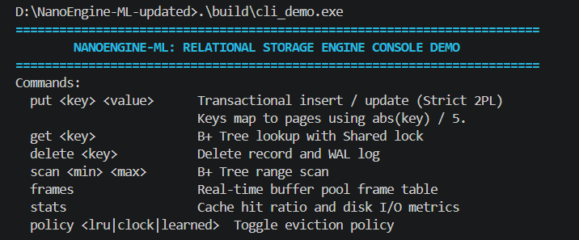
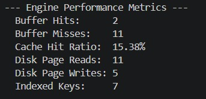
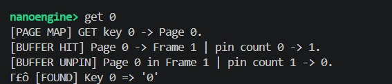

# NanoEngine-ML

**NanoEngine-ML** is a C++ relational storage-engine project that demonstrates core database internals through a command-line interface. The project brings together page-oriented storage, buffer-pool management, indexing, concurrency control, and write-ahead logging/recovery concepts.

> The repository's merged implementation is the source of truth. This README documents the features and commands visible in the current project/demo; future or partially implemented ideas should be labelled separately.

## Project highlights

- **Page-oriented storage:** records/keys are mapped to pages and accessed through the storage layer.
- **Buffer pool manager:** manages in-memory page frames, pin/unpin state, and dirty-page handling.
- **Replacement policies:** supports switching between `LRU`, `CLOCK`, and `LEARNED` eviction policies.
- **B+ Tree operations:** supports key lookup and range scans through the index.
- **Concurrency control:** transactional insert/update and shared-lock lookup are exposed in the console demo; the command help identifies Strict 2PL.
- **Write-ahead logging:** delete operations are described by the CLI as recording a WAL log.
- **Runtime statistics:** reports cache hits/misses, cache hit ratio, disk page reads/writes, and indexed-key count.

## Architecture at a glance

```text
                  CLI Demo
                     |
          +----------+----------+
          |          |          |
       Commands   Statistics   Policy switch
          |          |          |
          +----------+----------+
                     |
             Database Engine
                     |
       +-------------+-------------+
       |             |             |
    B+ Tree      Buffer Pool    Transactions
       |          Manager       / Locking
       |             |
       +------ Page Frames ------+
                     |
               Disk Manager
                     |
               Page Storage
                     |
              WAL / Recovery
```

## Console demo

Build and run the CLI executable, then use the commands printed by the application at startup.

### Available commands

| Command | Purpose |
|---|---|
| `put <key> <value>` | Transactional insert/update (Strict 2PL); keys are mapped to pages using `abs(key) / 5` |
| `get <key>` | B+ Tree lookup with a shared lock |
| `delete <key>` | Delete a record and write a WAL log |
| `scan <min> <max>` | B+ Tree range scan |
| `frames` | Display the real-time buffer-pool frame table |
| `stats` | Display cache hit ratio and disk I/O metrics |
| `policy <lru\|clock\|learned>` | Switch the page-eviction policy |

### Example: lookup and buffer-pool activity

The following captured run shows a lookup of key `0`, the page mapping, a buffer hit, and the page's pin-count transition from `0` to `1` and back to `0`.

```text
nanoengine> get 0
[PAGE MAP] GET key 0 -> Page 0.
[BUFFER HIT] Page 0 -> Frame 1 | pin count 0 -> 1.
[BUFFER UNPIN] Page 0 in Frame 1 | pin count 1 -> 0.
[FOUND] Key 0 => '0'
```

## Screenshots

### 1. CLI startup and command reference



### 2. Engine performance metrics

This is a sample captured metrics output from one run, not a benchmark guarantee.



### 3. B+ Tree lookup and buffer-pool pin/unpin



## Build and test

The repository uses CMake and C++20. From the repository root:

```bash
cmake -S . -B build
cmake --build build
```

Run the CLI demo from the build directory (the exact executable path may vary by generator/platform):

```bash
./build/cli_demo
```

On Windows with the executable shown in the demo:

```powershell
.\build\cli_demo.exe
```

Run the automated tests:

```bash
ctest --test-dir build --output-on-failure
```

## Buffer-pool concepts demonstrated

- **Frame table:** tracks which page is loaded in each in-memory frame.
- **Pin count:** prevents a page currently in use from being selected for eviction. A page is pinned when fetched and unpinned when the operation finishes.
- **Dirty-page tracking:** identifies modified pages that must be written back before their frame can be reused.
- **Replacement policy:** chooses a victim frame when the buffer pool needs space. The console supports `lru`, `clock`, and `learned` policy selection.
- **Statistics:** exposes buffer hits/misses, cache hit ratio, and disk page I/O counts.

## Example metrics

One captured run displayed:

| Metric | Value |
|---|---:|
| Buffer Hits | 2 |
| Buffer Misses | 11 |
| Cache Hit Ratio | 15.38% |
| Disk Page Reads | 11 |
| Disk Page Writes | 5 |
| Indexed Keys | 7 |

These numbers are included to illustrate the output format. They depend on the operations performed in that particular run.

## Repository structure

The current repository contains the following top-level areas:

```text
NanoEngine-ML/
├── NanoEngine-Storage/
├── apps/
├── include/
├── src/
├── tests/
├── CMakeLists.txt
└── README.md
```

## Learning objectives

This project provides practical exposure to:

- Page-based database storage and disk I/O
- Buffer-pool and frame-table management
- Pin/unpin lifecycle and dirty-page handling
- Page replacement strategies
- B+ Tree indexing and range scans
- Transaction locking and concurrency concepts
- Write-ahead logging and recovery concepts
- CMake-based C++ project organization and testing

## Contributors

Add or update contributor names and responsibilities to match the final merged repository/team agreement.

## Notes

- Run the commands from the project root unless otherwise stated.
- The metrics shown above are a captured example, not fixed expected values.
- The `LEARNED` policy is presented as a selectable replacement option. Its exact model/training details should be documented alongside the implementation once confirmed from the final source.
